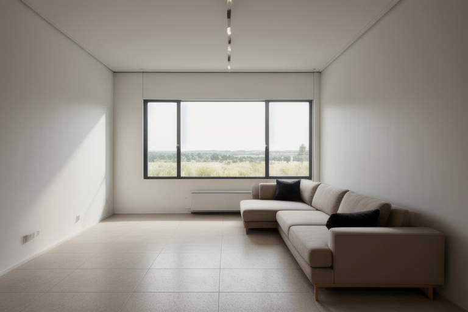
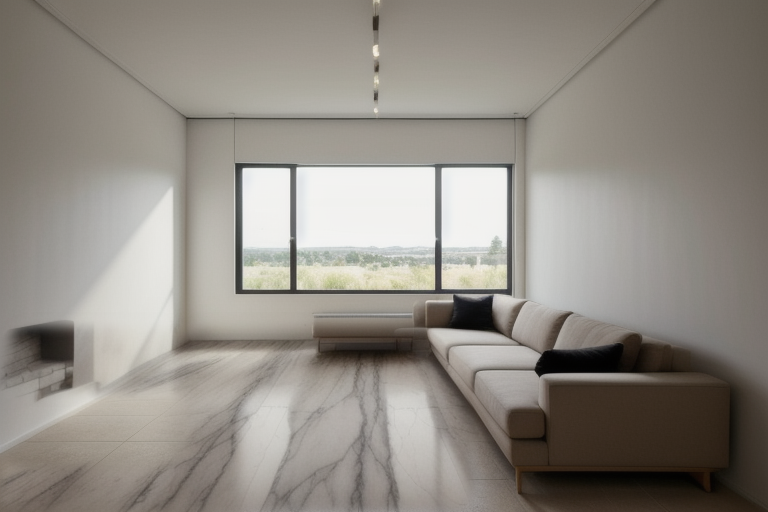
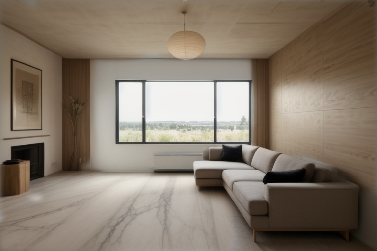

# Strata

Structure-locked AI material rendering for architects and interior designers, running on a local ComfyUI. Drop in a room photo or render, drop reference photos onto **Floor / Walls / Ceiling / Furniture**, and Strata re-finishes only those surfaces. Walls, doors, windows and columns stay pixel-identical. It then exports a costed specification proposal (PDF) with Philippine, tropical-rated materials.

## Sample

| Base | Floor only (marble reference) | Floor, walls and ceiling |
|---|---|---|
|  |  |  |

Rendered on a CPU-only i5-7400 with 8 GB RAM (Lite profile, 768 px, 6 LCM steps). Window, mullions, radiator and sofa stay pixel-identical because they are outside the masks. The decor on the left wall of the third image comes from its reference being a furnished-room collage; close-up material photos give clean finishes.

See [docs/ARCHITECTURE.md](docs/ARCHITECTURE.md) for the pipeline and how it departs from the original blueprint.

## Requirements

- Node.js 20+ (developed on 24)
- ComfyUI **0.42 or newer** (native SAM3, Depth Anything 3 and Canny nodes), with the
  [ComfyUI_IPAdapter_plus](https://github.com/cubiq/ComfyUI_IPAdapter_plus) custom node
- Google Chrome or Microsoft Edge (used headless for PDF export)

## Run

```bash
# 1. Start ComfyUI. No CORS flags needed.
#    Without an NVIDIA GPU use plain --cpu (no dtype flags; see "Performance").
cd D:\PROJECTS\ComfyUI
.venv\Scripts\python.exe main.py --listen 127.0.0.1 --cpu

# 2. Start Strata
cd "D:\PROJECTS\Strata PWA"
npm install
npm run build
npm start            # http://127.0.0.1:4787
```

Use `npm run dev` while developing. The service worker (offline shell, installable PWA) only registers in production builds.

Strata looks for ComfyUI at `http://127.0.0.1:8188` and auto-detects the ComfyUI folder (a sibling `../ComfyUI`, `COMFYUI_PATH`, or common locations). Change either in **Settings**.

## First run

1. Open **Model manager**. Strata recommends **Lite** (CPU / ≤8 GB VRAM) or **Studio** (SDXL, NVIDIA ≥12 GB) from your hardware. Download the required models; they stream straight into `ComfyUI/models/…`, resume after dropped connections, and ComfyUI picks them up without a restart.
2. Drop a base image on the canvas.
3. **Auto-detect** (SAM3) masks floor, walls, ceiling, furniture and protected structure. Refine with Brush `B`, Eraser `E` or Magic wand `W`; `1`–`4` and `0` switch layers.
4. Drop reference photos into a surface. Strata classifies the texture and picks a tropical-rated catalogue material (overridable).
5. **Generate** (`Ctrl+Enter`). A live preview streams while sampling; the result opens in a before/after slider.
6. Fill in room dimensions in **Project**, then **Proposal → Export PDF**.

## Keyboard

| Key | Action |
|---|---|
| `V` / `B` / `E` / `W` | Pan / brush / eraser / magic wand |
| `1` `2` `3` `4` `0` | Floor / walls / ceiling / furniture / protected |
| `[` `]` | Brush size |
| `Alt` + paint or click | Erase / subtract |
| `Space` + drag, scroll | Pan |
| `Ctrl` + scroll | Zoom |
| `F` / `C` / `M` | Fit / toggle compare / toggle masks |
| `Ctrl+Z` / `Ctrl+Enter` | Undo mask edit / generate |

## Performance (CPU / 8 GB machines)

Measured on an i5-7400 with 8 GB RAM (`scripts/profile-generate.mts` reproduces these per node):

| Lite render, floor only | Time |
|---|---|
| Full frame, CFG 1.5, 4K every render (old defaults) | 911 s |
| Crop to edited region, CFG 1.0, 4K on demand (new defaults) | 550 s |
| UI **Generate** with a reference image, fp8 UNet | 493 s cold (+~135 s once per new reference image) |
| UI **4K** button on a finished render | 95 s |

What Strata does automatically:
- **Crops** diffusion to the edited region plus context and pastes it back over the untouched original.
- **CFG 1.0** with LCM, so ComfyUI skips the negative pass (half the work per step).
- **4K on demand**: click **4K** on the render you keep; proposal export upscales automatically.
- **Encodes reference images in a separate small job** and caches the embeddings, so the CLIP Vision encoder is never in memory together with the diffusion models (the point where 8 GB machines crashed).
- **Unloads ComfyUI's model cache** before each job on CPU; keeping everything resident crashed with out-of-memory.

What you should do:
- Start ComfyUI with plain **`--cpu`**, no dtype flags. Each global flag breaks something on CPU: `--fp16-unet` breaks IP-Adapter ("mat1 and mat2 must have the same dtype"); `--fp8_e4m3fn-unet` breaks SAM3 Auto-detect ("slow_conv2d_cpu not implemented for Float8_e4m3fn"). Strata detects both and explains before running.
- In **Model manager**, click **Convert** on *Realistic Vision 5.1 UNet* and *text encoder*. Strata then loads only the render UNet with fp8 weight storage (a quarter of fp32, still computed in fp32), per model, so SAM3 and IP-Adapter keep full precision. Without this, the full fp32 checkpoint ran an 8 GB machine out of memory.
- Also **Convert** *CLIP ViT-H/14 (fp16, low-memory)*. The fp16 copy is identical to what ComfyUI already uses in memory, minus a ~3.8 GB loading spike.
- Iterate in the **Draft** quality preset (512 px, 4 steps); render the keeper in **Standard**. Back-to-back renders keep the models loaded, so only the first render after starting ComfyUI or after Auto-detect pays the model-loading cost.
- **Close heavy apps** (editors, extra browser tabs, a second ComfyUI) before rendering. With under ~1.5 GB of RAM free, Windows swaps model weights to disk on every step; the Render tab warns you.
- Keep **free space on C:** (or move the pagefile to another drive). A full C: stops the pagefile from growing, and ComfyUI then crashes with `os error 1455`.

## Tests

```bash
npm test          # graph builders vs. a captured ComfyUI 0.42 schema, BOQ, material rules, texture classifier, proposal HTML
npm run test:e2e  # Playwright, installed Chrome: every page and button, Generate/4K/PDF with ComfyUI mocked (~1 min)
npm run typecheck

# Per-node timing of the real generation graph against a running ComfyUI:
npx tsx scripts/profile-generate.mts --project <id> --surfaces floor --crop
```

## Material data

`lib/materials.ts` holds the built-in catalogue (sintered stone, slim porcelain + mandatory epoxy grout, PU-cement screed, SPC with vapour barrier, anti-mould paint, MR gypsum, fibre-cement and more). Rates are **indicative** Metro Manila PHP figures and every entry is editable in the Material Library. Confirm suppliers and prices by quotation before issuing a proposal.
